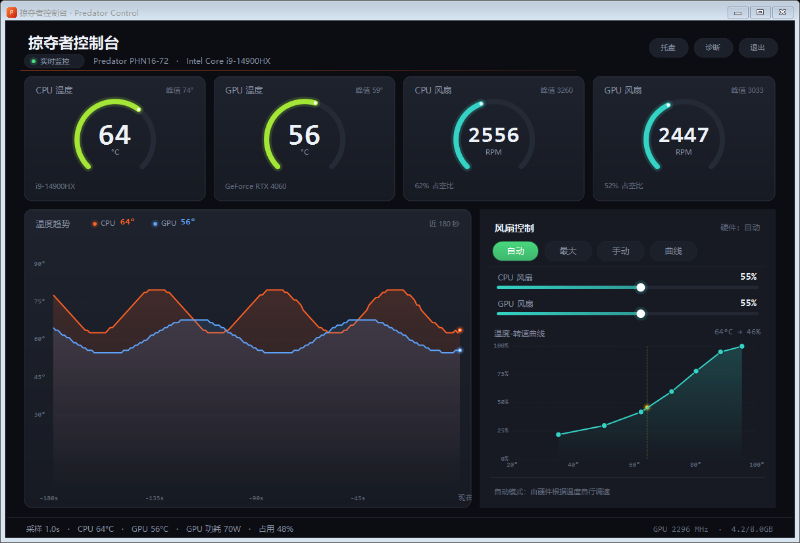

# 掠夺者控制台 · Predator Control

[](LICENSE)
[](#运行要求)
[](https://dotnet.microsoft.com/)

一个轻量的 Windows 硬件监控 + 风扇控制工具，专为 **Acer Predator（宏碁掠夺者）** 游戏本编写，
用于替代识别不稳、启动缓慢的 PredatorSense。

> 在 Acer Predator PHN16-72（Helios Neo 16 / i9-14900HX / RTX 4060 Laptop / BIOS V1.17 / Win11）上开发与实测。



## 下载

到 [**Releases**](../../releases/latest) 页面下载 `PredatorControl.exe`，双击即可运行，免安装、免运行库。

> 首次启动会请求管理员权限——这是读取 Acer 硬件接口的前提，不授权只能看界面、读不到数据。

## 功能

- **实时监控**：CPU 温度、GPU 温度、CPU / GPU 风扇实际转速（RPM）、GPU 功耗 / 频率 / 占用 / 显存
- **温度趋势**：180 秒滚动曲线，数据缺失自动断线，不会画出假谷底
- **风扇四模式**
  - 自动：交还固件自行调速
  - 最大：双风扇全速
  - 手动：滑块直接指定转速百分比
  - 曲线：按温度自动调速，曲线可拖动编辑，带 3℃ 回差防抖
- **托盘常驻**：图标提示实时温度，`--tray` 参数可静默启动
- **硬件自检**：「诊断」按钮导出每一步接口调用的原始返回值
- 退出时自动把风扇交还「自动」，不会锁死转速

## 为什么 PredatorSense 会识别不到硬件

温度和转速来自 Acer 私有 ACPI WMI 接口 `root\WMI → AcerGamingFunction`，
该接口受权限保护：

- 非管理员访问实例返回 `拒绝访问`
- 用类级方法调用则返回 `0x80070057 无效的方法参数`

上层软件读不到时，表现就是「识别不到硬件」。本程序启动即申请管理员权限，
并在每次读取失败时把具体原因显示在状态栏，而不是静默失败。

## 用到的接口

**Acer ACPI WMI**（字段定义参考 Linux 内核 `acer-wmi` 驱动）

| 用途 | 方法 | 输入 / 输出 |
|---|---|---|
| 传感器读数 | `GetGamingSysInfo` | `in = 0x0001 \| (sid << 8)`，`out[7:0]=status`，`out[23:8]=读数` |
| 风扇转速 | `GetGamingFanSpeed` | `in = fanId`，`out[15:8]=百分比` |
| 设置转速 | `SetGamingFanSpeed` | `in = fanId \| (pct << 8)` |
| 风扇模式 | `Get/SetGamingFanBehavior` | bitmap `CPU=0x01 / GPU=0x08`，模式 `AUTO=1 / TURBO=2 / CUSTOM=3` |

- 传感器 ID：`0x01` CPU 温度 / `0x02` CPU 风扇 / `0x03` 外部温度 2 / `0x06` GPU 风扇 / `0x0A` GPU 温度
- 风扇 ID：`CPU = 0x01`，`GPU = 0x04`
- 注意：`GetGamingFanSpeed` 在**自动模式**下恒定返回 `0%`，只有 CUSTOM 模式才回报真实占空比，
  所以本程序的风扇仪表以 **RPM** 为准

**NVIDIA**：优先使用 NVML（`nvml.dll`），失败时回退 `nvidia-smi`。
NVML 的 `nvmlDeviceGetFanSpeed` 在笔记本上通常返回 NOT_SUPPORTED，风扇数据以 Acer 接口为准。

## 运行要求

- Windows 10 / 11 x64
- 需要管理员权限（读取 Acer 硬件接口的前提）
- 单文件绿色版，无需安装，无需 .NET 运行库

## 从源码构建

需要 .NET 8 SDK：

```bash
dotnet publish -c Release -r win-x64 --self-contained true \
  -p:PublishSingleFile=true -p:IncludeNativeLibrariesForSelfExtract=true \
  -p:EnableCompressionInSingleFile=true -o publish
```

## 资源占用（实测）

| 状态 | CPU | 内存 |
|---|---|---|
| 主界面可见 | 0.6 ~ 0.9% 单核（整机约 0.02%） | ~150 MB |
| 最小化到托盘 | ~0.05% 单核 | ~140 MB，长期稳定 |

采样周期 1 秒，数据采集全部在进程内完成，不会反复启动外部程序。

## 命令行参数

| 参数 | 说明 |
|---|---|
| `--tray` | 启动后直接缩到托盘（适合开机自启） |
| `--demo` | 演示模式，使用模拟数据展示界面 |

## 已知限制

- 目前仅在 PHN16-72 上验证；其他 Predator 机型的传感器 ID / 风扇 ID 可能需要按机型调整
- 手动 / 曲线模式请勿与 PredatorSense 同时使用，两者会抢风扇控制权
- 曲线模式最低建议不低于 25%，过低在满载时可能过热降频

## 免责声明

风扇控制涉及硬件底层接口，使用风险自负。程序退出时会自动恢复「自动」模式。

## License

[MIT](LICENSE) © 2026 Flybaby1

